<!-- 🐰 Profile README — meelvil · every visual has a dark + light version, picked automatically by GitHub -->

  <picture>
    <source media="(prefers-color-scheme: dark)" srcset="assets/header-dark.svg"/>
    <source media="(prefers-color-scheme: light)" srcset="assets/header-light.svg"/>
    
  </picture>

  <a href="https://www.youtube.com/@melv1l"><b>YouTube</b></a> ↗ &nbsp;·&nbsp;
  <a href="https://github.com/meelvil/bunny-bot"><b>Bunny Bot</b></a> ↗ &nbsp;·&nbsp;
  <a href="https://github.com/meelvil/generateur-commandes"><b>CommandsHelper</b></a> ↗ &nbsp;·&nbsp;
  <b>42 Lyon</b>

 

<h3 align="center">Video. Made with care. ✂️</h3>

  Nintendo modding tutorials on YouTube, from full 16:9 guides to quick Shorts. 
  Cut in <b>Premiere Pro</b>, animated in <b>After Effects</b>, designed in <b>Illustrator</b>.

  <picture>
    <source media="(prefers-color-scheme: dark)" srcset="assets/editing-timeline-dark.svg"/>
    <source media="(prefers-color-scheme: light)" srcset="assets/editing-timeline-light.svg"/>
    
  </picture>

  <picture>
    <source media="(prefers-color-scheme: dark)" srcset="https://skillicons.dev/icons?i=pr%2Cae%2Cai%2Cps%2Cblender&theme=dark"/>
    <source media="(prefers-color-scheme: light)" srcset="https://skillicons.dev/icons?i=pr%2Cae%2Cai%2Cps%2Cblender&theme=light"/>
    
  </picture>

 

<h3 align="center">Latest on YouTube.</h3>

<!-- YOUTUBE:LATEST -->

  <a href="https://www.youtube.com/watch?v=PX5pezQ_0Js">
    <picture>
      <source media="(prefers-color-scheme: dark)" srcset="assets/youtube-latest-dark.svg?v=PX5pezQ_0Js"/>
      <source media="(prefers-color-scheme: light)" srcset="assets/youtube-latest-light.svg?v=PX5pezQ_0Js"/>
      
    </picture>
  </a>

  <a href="https://www.youtube.com/@melv1l">
    <picture>
      <source media="(prefers-color-scheme: dark)" srcset="assets/youtube-button-dark.svg"/>
      <source media="(prefers-color-scheme: light)" srcset="assets/youtube-button-light.svg"/>
      
    </picture>
  </a>

 

<h3 align="center">Code. Built hands-on. 💻</h3>

  🐰 <a href="https://github.com/meelvil/bunny-bot"><b>Bunny Bot</b></a> 
  Discord bot for the Nintendo modding community: console guides, OCR error lookup, Switch serial checker.

  🧩 <a href="https://github.com/meelvil/generateur-commandes"><b>CommandsHelper</b></a> 
  Electron app to build discord.js commands visually, with a live Discord-style preview.

  📦 <a href="https://github.com/LED-N/Fortnite-ChestCounter"><b>Fortnite ChestCounter</b></a> 
  Contributor: 6 new in-game overlay styles.

  🎓 <b>42 Lyon</b> 
  C from the ground up: <code>libft</code>, <code>ft_printf</code>, and more.

  <picture>
    <source media="(prefers-color-scheme: dark)" srcset="https://skillicons.dev/icons?i=c%2Cjs%2Cnodejs%2Cpy%2Celectron%2Cdiscord%2Clinux%2Cgit%2Cvscode&theme=dark"/>
    <source media="(prefers-color-scheme: light)" srcset="https://skillicons.dev/icons?i=c%2Cjs%2Cnodejs%2Cpy%2Celectron%2Cdiscord%2Clinux%2Cgit%2Cvscode&theme=light"/>
    
  </picture>

 

  <picture>
    <source media="(prefers-color-scheme: dark)" srcset="https://raw.githubusercontent.com/meelvil/meelvil/output/snake-dark.svg"/>
    <source media="(prefers-color-scheme: light)" srcset="https://raw.githubusercontent.com/meelvil/meelvil/output/snake-light.svg"/>
    
  </picture>

Designed in France 🇫🇷 &nbsp;·&nbsp; Mods Switch, 3DS, DSi, Wii and Wii U

